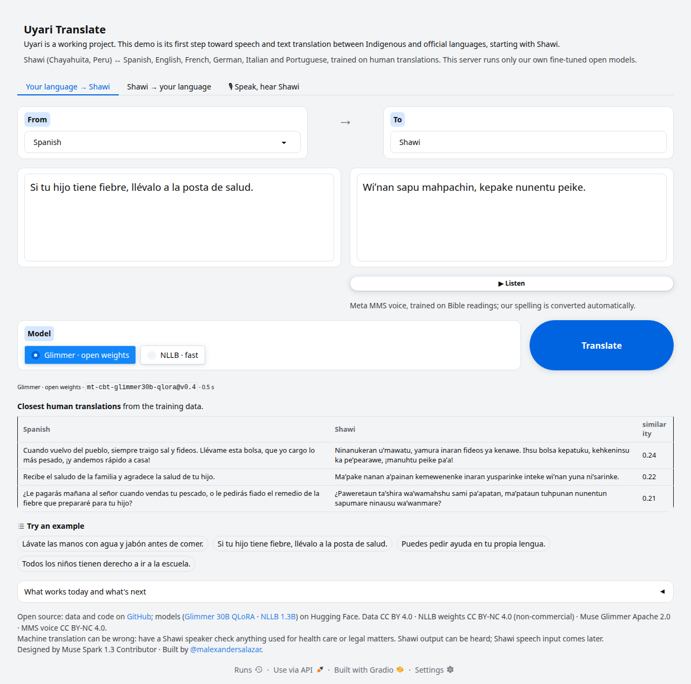

# Uyari

*Uyari* means "listen" in Quechua.

**Uyari turns a community's own translations into open translation models between Indigenous and official
languages, for text and speech.** The first pair is Shawi (Peru) ↔ Spanish, English, French, German, Italian
and Portuguese, on Meta Muse Glimmer. By Alexander Salazar.

**Problem statement:** Build for Your World

**[Live demo](https://uyari.ngrok.dev)** · **[Video](https://www.youtube.com/watch?v=mPu7ZLth2uc)** · Models on
Hugging Face: [Muse Glimmer 30B QLoRA](https://huggingface.co/malexandersalazar/uyari-mt-cbt-glimmer30b-qlora) ·
[NLLB-200 1.3B](https://huggingface.co/malexandersalazar/uyari-mt-cbt-nllb1.3b)

## Hackathon submission: what existed before, what was built

Everything in this repository was built during the hackathon except two inputs we made before it and own.
They are disclosed here and kept in their own, labelled folders.

| | What | When | Where |
|---|---|---|---|
| **Input, made before the hackathon** | 10,000 Spanish source sentences, generated with Claude Opus 4.8 from the design matrix | June 2026 | [`primary/spa_Latn/chunks/generated/2026-06_opus48_0001.csv`](primary/spa_Latn/chunks/generated/2026-06_opus48_0001.csv) |
| **Input, made before the hackathon** | 3,578 human Shawi translations of 3,575 of those sentences: commissioned work, released under CC BY 4.0 by its rights holders | July to October 2026 | [`languages/cbt_Latn/contributions/`](languages/cbt_Latn/contributions/) (`2026-11_uyari_0001` to `0003`), [decision 0004](docs/decisions/0004-commissioned-shawi-contributions.md), [`DATA_LICENSE.md`](DATA_LICENSE.md) |
| **Built during the hackathon** | Everything else: the toolkit ([`src/uyari/`](src/uyari/)) with its data format, validator and builds; generation on Meta models and the 101,363 Muse Spark sentences; the translation of all 111,363 sentences into seven more languages; both fine-tuned models; the spelling converter that makes Meta's MMS Shawi voice usable (it can read 99.99% of the letters in our Shawi text, 86% without); the demo | 2 to 4 November 2026 (UTC): git history, the `gen_date` of every batch, each model's `trained_at` | the rest of the repository |

The contribution folders are named by the month they were filed (`2026-11_…`). Each `contribution.yaml`
records a deliberately wide collection window, 2026-06-01 to 2026-11-01; the translations themselves were made
from July to October 2026.

## The problem

About **476.6 million** Indigenous people — over 6% of humanity — live in
90 countries. They are nearly three times more likely to live in extreme poverty; 3,193 of 7,159 living
languages (about 45%) are endangered; 40% of people worldwide lack education in a language they understand,
up to 90% in some low- and middle-income countries.

No global count exists of who cannot use their country's official language at all. In just four Latin
American countries it is about **3.1 million**: Mexico **865,972** (direct census count), Guatemala
**~1.64M**, Peru **~335,576**, Bolivia **~267,729** — plus millions more who manage daily life but cannot
follow a diagnosis or a court hearing. Mexico's 7.36M Indigenous-language speakers alone outnumber the
speakers of Danish, Finnish or Norwegian. Seventy percent of Indigenous people live in Asia and the Pacific,
where no comparable figure exists.

The cost falls on health, schooling and justice: in Guatemala the language barrier was "the most important
obstacle" to Indigenous women's use of reproductive health services, and their maternal mortality was
**166 vs 78** per 100,000 live births; in Mexico Indigenous-language speakers average 6.2 years of
schooling, **monolinguals 1.4**; laws recognising Indigenous languages are common, interpreters are not.
Monolinguals are disproportionately older, female and non-literate — **speech is not optional**.

Full figures with sources: [`PROBLEM.md`](PROBLEM.md). How Uyari answers it:
[`METHODOLOGY.md`](METHODOLOGY.md). Both in English, Spanish, Portuguese, French, German, Italian, Hindi
and Thai ([`docs/`](docs/README.md)).

**Runs on Meta Muse Glimmer (open weights) on our own RTX 4090** (trained on a Modal H100). Uyari turns a community's own
translations and recordings into translation models between any Indigenous or under-served language and the
official language its speakers need. Five use cases per language pair: text to text in both directions,
speech to speech in both directions, and speech to text for the Indigenous language. A language is a folder;
data is a folder inside it; nobody changes code.

The first language pair is **Shawi ↔ Spanish** (Peru), which began with maternal health: Shawi communities
meet health services that offer no support in their language. It is the first case, not a limit: the same
data now also pairs Shawi with **English, French, German, Italian and Portuguese**, and any language is
added as a folder.

## Live demo

**<https://uyari.ngrok.dev>**: the page runs on our RTX 4090 and is published through ngrok.



Three things to try:

1. **Spanish → Shawi, with audio.** First tab: type *Si tu hijo tiene fiebre, llévalo a la posta de salud.* It
   translates as you type; press **Listen** to hear the Shawi.
2. **Shawi → English.** Second tab: set the target to English and pick one of the Shawi sentences from our data.
3. **Voice in, Shawi out.** Third tab: speak Spanish, English, French or Portuguese and get Shawi text and
   speech. Voice input uses your own Meta API key, for that request only.

Under every answer are the three closest human translations from the training data, with their similarity, so
each answer can be checked against real human work. Muse Glimmer is the default; NLLB is on the **Model**
switch.

## Results

**3,575 human translations → 21,450 sentence pairs in 12 directions**, because every Spanish sentence keeps
its id in all six official languages: each Shawi translation pairs with Spanish, English, French, German,
Italian and Portuguese. One model per backend covers all twelve directions (build `data-2026.11-six`).

chrF++ on the held-out test set (322 sentences per direction, scored once, at promotion):

| Direction | Muse Glimmer 30B QLoRA (`v0.4`) | NLLB-200 1.3B (`v0.3`) | Retrieval floor |
|---|---|---|---|
| Spanish → Shawi | 41.7 | 43.2 | 23.4 |
| Shawi → Spanish | 44.4 | 45.8 | 22.0 |
| English → Shawi | 40.9 | 43.3 | 22.2 |
| Shawi → English | 44.9 | 45.5 | 22.0 |
| French → Shawi | 39.9 | 43.1 | 23.3 |
| Shawi → French | 44.9 | 46.3 | 22.4 |
| German → Shawi | 40.9 | 42.6 | 22.5 |
| Shawi → German | 43.4 | 44.1 | 22.6 |
| Italian → Shawi | 41.1 | 43.2 | 23.9 |
| Shawi → Italian | 43.8 | 44.7 | 22.4 |
| Portuguese → Shawi | 41.3 | 43.3 | 22.8 |
| Shawi → Portuguese | 41.9 | 43.0 | 21.6 |
| **Mean** | **42.4** | **44.0** | **22.6** |

The retrieval floor returns the human translation of the most similar training sentence; a model is served
only if it beats it in every direction. Glimmer was trained in 108 min on a Modal H100 for about US$7 and is
served on our 4090; NLLB trained in 45 min on the 4090. On validation Glimmer is 1.8 below NLLB into Shawi and
0.5 below out of it (all six languages). Each epoch shows every Shawi sentence as a target from 2 of its 6 sources, and checkpoints are chosen by chrF++ into Shawi. The English, French,
German, Italian and Portuguese references are machine-translated with Muse Spark; the Shawi is human
([details](primary/eng_Latn/README.md)).

## Models: what each one does and where it runs

| Model | Job | Weights | License | Where it runs |
|---|---|---|---|---|
| **Muse Glimmer 30B**, fine-tuned: `mt-cbt-glimmer30b-qlora@v0.4` | The headline translator (QLoRA, Shawi ↔ six official languages, the demo default); the Gatekeeper agent's reviewer; free local Spanish generation | [LoRA adapter and GGUF](https://huggingface.co/malexandersalazar/uyari-mt-cbt-glimmer30b-qlora) | Apache 2.0 | Trained on a Modal H100 (Modal is a hackathon partner; [`scripts/modal_glimmer.py`](scripts/modal_glimmer.py): the 4-bit model does not fit 24 GB for training); served on our RTX 4090 as Unsloth's 4-bit GGUF with the adapter, through llama-server (`uyari serve`, 16.5 GB) |
| **NLLB-200 1.3B**, fine-tuned: `mt-cbt-nllb1.3b@v0.3` | Fast baseline, the demo's second choice | [Weights](https://huggingface.co/malexandersalazar/uyari-mt-cbt-nllb1.3b) | CC BY-NC 4.0 | Trained on our RTX 4090; runs on the 4090, an RTX 3060 or a CPU |
| **Muse Spark 1.3 Contributor** | Spanish source-sentence generation (about $0.02 per 1,000 sentences) and their translation into the other official languages (about $0.02 per 1,000 sentences per language); in the demo, a spoken language into Spanish only if no model takes it into Shawi (visitor's key). It never sees Shawi: the Contributor tier lets Meta train on prompts | API | | Meta Model API |
| **Muse Voice Transcribe** | Spanish, English, French and Portuguese voice input in the demo, paid with the visitor's own key (the server never uses its own) | API | | Meta Model API |
| **MMS-TTS** (`facebook/mms-tts-cbt`) | Reads Shawi aloud in the demo and `uyari s2s`, through our spelling converter; replaced by a voice of our own once there are recordings | Meta's, unchanged | CC BY-NC 4.0 | Our server, CPU |
| **Omnilingual ASR** | **Planned, not used yet:** Indigenous speech input once Shawi recordings exist | | | RTX 4090 |

**Why Meta for generation.** We regenerated 200 cells of our first Spanish batch with the identical prompt;
only the model changed. Muse Spark 1.3 Contributor cost $0.021 per 1,000 sentences against ~$0.64 for the
model we started with (3.3%). It returned well-formed output for 100% of requests (96.5% before) and wrote
slightly more varied Spanish (distinct-2 0.891 vs 0.870). The earlier model kept the length buckets a
little more often (94.5% vs 89.0%). With Muse Glimmer the same generation runs on our own GPU with no API
cost and nothing leaving our hardware. Full table: [`reports/gen-comparison.md`](reports/gen-comparison.md).

## What exists today

| | Status |
|---|---|
| Shawi (`cbt_Latn`) ↔ Spanish, English, French, German, Italian, Portuguese, **text** | 3,575 human translations of Spanish sentences. Every Spanish sentence has a twin with the same id in each language (machine-translated with Muse Spark), so all 3,575 human Shawi translations pair with all six. One model per backend covers all twelve directions. Scores: [Results](#results). |
| Spanish, English, French or Portuguese **speech** in → Shawi text **and speech** out | Demo, one action: Muse Voice Transcribe (the visitor's own Meta key) → our translator → Shawi read aloud by Meta's MMS voice on our own server. That voice learned an older spelling from Bible readings, so a spelling converter ([`tts.yaml`](languages/cbt_Latn/tts.yaml)) rewrites our text for it: it can read 99.99% of the letters in our Shawi text, 86% without. Also `uyari s2s`. |
| Shawi **speech** in, and a Shawi voice of our own | **Not yet: there are no Shawi recordings.** The format, validator, build and ASR/TTS pipelines run on a labelled synthetic fixture; [`languages/cbt_Latn/NEEDS.md`](languages/cbt_Latn/NEEDS.md) asks for recordings. |
| Spanish source sentences | 111,363 chunks from a fixed design matrix: the 10,000 of June 2026, and 101,363 generated with Muse Spark 1.3 Contributor during the hackathon. Same prompt, **3.3% of the cost** with Muse Spark, **no API cost** with Muse Glimmer ([details](primary/spa_Latn/README.md)). |

## Agents

Two agents keep the loop running between contributions and models. Both are commands in the CLI, and each has
a GitHub workflow that runs it on a self-hosted runner: GitHub only triggers the job, and the GPU work runs on
our own machine, so the contributions the agents read never leave it.

* **Gatekeeper** (`uyari gatekeeper --contribution C`; [`review.yml`](.github/workflows/review.yml), on every
  pull request). Deterministic checks first, and they decide: validator failures, Spanish pasted in the Shawi
  column, rows copied from accepted contributions, text unlike any accepted Shawi. Then Muse Glimmer, on our
  own GPU, writes the review in Spanish and scores a sample of rows against the nearest accepted human pairs.
  It recommends; a person merges. It does not detect machine translation.
* **Trainer** (`uyari trainer --language cbt_Latn --open-pr`; [`train.yml`](.github/workflows/train.yml), on
  every merge that adds data). Build → train → evaluate → promote → model card → `NEEDS.md` → pull request.
  Guardrails: it never merges; it never reads the test set before promotion; it promotes only at ≥ +0.5 chrF++
  over the current model on the directions both share, and above the retrieval floor in every direction.

**Status:** both agents run from the command line. The workflows are in place, but the self-hosted runner is
not registered yet, so neither has run on GitHub. The models in [`models/registry.yaml`](models/registry.yaml)
were registered with `uyari register`, which applies the Trainer's promotion rule.

## Quick start

**Windows or Linux, data tools only (no GPU needed):**

```bash
uv sync --python 3.11 --extra dev --extra speech
uv run uyari validate                       # gate 1: schemas, ids, apostrophes, duplicates, audio
uv run uyari build --tag data-2026.11-six --as-of 2026-11-02 --officials spa_Latn,eng_Latn,fra_Latn,deu_Latn,ita_Latn,por_Latn            # contributions -> builds/<tag>/<lang>/{mt,asr,tts}.parquet + MANIFEST.json
uv run uyari build --tag data-2026.11-six --as-of 2026-11-02 --officials spa_Latn,eng_Latn,fra_Latn,deu_Latn,ita_Latn,por_Latn --verify   # recompute: same tag -> same hashes on any OS
uv run pytest -q
uv run uyari demo --no-share                # Uyari Translate on http://localhost:7860 (needs a trained model)
```

`uyari demo` starts the Muse Glimmer server itself when a Glimmer adapter is registered; if that server cannot
start, the page leaves Glimmer out and serves NLLB. Without `--no-share` it also prints a public
`https://….gradio.live` link: a free tunnel for trying it from another device, valid up to a week while the
process runs, new on every restart. The public demo at <https://uyari.ngrok.dev> is the same page on our RTX
4090, published through ngrok at a fixed address. The page serves only our fine-tuned models and reads Shawi
aloud with a voice on the same machine; its optional voice input (Spanish, English, French, Portuguese) asks
each visitor for their own Meta API key.

**The RTX 4090 (Ubuntu):** see [`docs/RUNBOOK-4090.md`](docs/RUNBOOK-4090.md).

```bash
bash scripts/setup_ubuntu.sh check && python scripts/check_4090.py   # prove the GPU stack first
bash scripts/setup_ubuntu.sh project
make build floor train-nllb train-glimmer   # retrieval floor, NLLB 1.3B (<1 h), Glimmer QLoRA (~2 h on Modal)
make demo                                    # the Gradio page (it starts the Glimmer server) with a share link
```

## The pipelines

| Stage | Command | What it does |
|---|---|---|
| Consolidate | `uyari build --tag data-YYYY.MM` | Merged contributions → one table per task per language; takedowns and corrections applied; test rows in separate files; hashed manifest |
| Training data | `uyari prepare --recipe R` | Both directions, filters, chat formatting, tokenizer coverage check, reversible `ʼ` codec |
| Train | `uyari train --recipe R` | `seq2seq` (NLLB) or `qlora` (Glimmer via Unsloth; PEFT elsewhere). Recipes are the only configuration |
| Evaluate | `uyari eval --model M` (`--final` once for test) | chrF++ and BLEU per direction and domain, against the retrieval floor |
| Generate Spanish | `uyari generate plan / run / collect / dedup / compare` | Muse Spark or Muse Glimmer; `--estimate` prints the cost before anything is sent |
| Another official language | `uyari primary translate --target eng_Latn` | Machine-translates the source sentences, same chunk ids, labelled `machine_translated`; `--estimate` first |
| Review | `uyari gatekeeper --contribution C` | Validator + language check + copied rows + Glimmer's written review, in Spanish |
| Train loop | `uyari trainer --language cbt_Latn --open-pr` | Build → train → evaluate → promote (≥ +0.5 chrF++ and above the floor) → card → `NEEDS.md` → pull request |
| Speech | `uyari transcribe`, `uyari asr infer/eval`, `uyari tts check-voice`, `uyari s2s` | Speech chain; Shawi spoken through the MMS voice and `languages/cbt_Latn/tts.yaml`; text output where no usable voice exists |

Every command takes `--root` to run on another data root (the tests use a synthetic fixture).

## Money and data

* **Bring your own key:** the demo server runs only our fine-tuned models and never uses its own API key;
  paid features (voice input) use the visitor's key, for that request only, never stored. The CLI uses
  your own `META_API_KEY`, and every paid command has `--estimate`.
* **Budget:** USD 150 for the project's own API use. Every call is in `.uyari/ledger.jsonl`; each run has a cap
  (`generate` $1, `transcribe` $2, everything else $0 because it is local). `uyari llm spend`.
  Spent so far: $15.74 (generation $2.16, translation into seven languages $13.58: the ledger cost noted on
  every batch in `primary/*/primary.yaml`). Rented GPUs (Modal, a hackathon partner, for Glimmer's training):
  about US$7 for the published run (`v0.4`), about US$30 across all six runs.
* **Data policy:** every model in [`config/llm.yaml`](config/llm.yaml) declares what it may see.
  Anything containing Shawi goes only to models on our own hardware, or to a GPU we rent to run our own
  training code (Glimmer on Modal; never the test split: [decision 0010](docs/decisions/0010-training-on-rented-gpus.md));
  the code refuses otherwise.
* **Privacy:** row ids are pseudonymous; `uyari privacy-check` runs before every commit.

## Repository map

```text
primary/spa_Latn/        the Spanish sentences every language translates (+ matrix.yaml for generation)
primary/<lang>/          the same sentences in English, French, German, Italian, Portuguese, Hindi and Thai
                         (machine-translated, same ids; Hindi and Thai are not trained on yet)
languages/cbt_Latn/      language.yaml, NEEDS.md, contributions/<YYYY-MM>_<org>_<nnnn>/
schemas/  registry/      JSON Schemas (column order lives here), language code tables
recipes/                 one YAML per training run
builds/<tag>/            MANIFEST.json (parquet is not in git; rebuilt from the tag)
models/                  registry.yaml, model cards and scores (weights are not in git)
reports/                 generation comparison, side-by-side translations
src/uyari/               the code (one CLI: `uyari`)
demo/                    Gradio demo (4090)
contributing/            how to contribute, rights and consent templates, takedowns.csv, in 8 languages
docs/                    PROBLEM and METHODOLOGY in 7 more languages, decisions, runbook
```

[`PROBLEM.md`](PROBLEM.md) · [`METHODOLOGY.md`](METHODOLOGY.md) · [`contributing/`](contributing/README.md) ·
[`CREDITS.md`](CREDITS.md) · Code: Apache 2.0 · Data: CC BY 4.0 ([`DATA_LICENSE.md`](DATA_LICENSE.md))

**Commercial use.** The code, the data and the Glimmer adapter allow it with credit ([`NOTICE`](NOTICE)),
including companies deploying Uyari for clinics. The NLLB fine-tune and the MMS voice are CC BY-NC 4.0:
non-commercial only.

---
*Documentation transparency: this README was enhanced with Muse Spark 1.3 Contributor. A human defined
what mattered and verified the figures against [`PROBLEM.md`](PROBLEM.md); the model condensed them into
the brief introduction above.*
